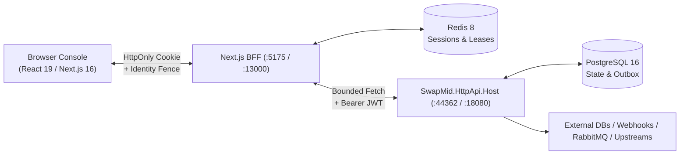

# SwapMid

[](LICENSE)
[](https://dotnet.microsoft.com/)
[](https://abp.io/)
[](https://nextjs.org/)
[](https://www.typescriptlang.org/)

English | **[简体中文](README.zh-CN.md)**

**SwapMid** is an open-source, production-grade **Enterprise Integration & Data Swap Middleware** built on **.NET 10 (ABP v10)** and **Next.js 16 (React 19)**. It unifies cross-database streaming ETL pipelines, durable event/webhook delivery, and governed API gateway forwarding behind a security-hardened BFF admin console.

---

## Highlights

- **Streaming Data Integration & Idempotent Receipt v1**
  - Multi-source connectors across **PostgreSQL**, **SQL Server**, **MySQL**, **REST APIs**, and **CSV / Excel** files.
  - Batch streaming execution without full-table memory buffering, paired with transactional **Target Receipt v1** (`__swapmid_etl_receipt_v1`) to guarantee idempotent target writes.
- **Durable Message Bus & Multi-Channel Dispatch**
  - Topic/subscription routing with persistent delivery attempt tracking, automatic backoff retries, and one-click manual replay.
  - Built-in **HTTP Webhook** (`HMAC-SHA256` `X-SwapMid-Signature` + outbound SSRF guard), **RabbitMQ**, and **BotWebhook** (Generic JSON, Slack, Feishu/Lark, DingTalk, WeCom) channels.
- **Governed API Gateway & Client Credentials**
  - Dynamic API groups and route forwarding (`/gateway/{groupPrefix}/{routePath}`), interactive request debugger, and **OpenIddict** `client_credentials` apps (`external-integration` scope) for external partners.
- **Zero-Browser-Token BFF Console**
  - Next.js 16 BFF stores OAuth2 tokens exclusively in Redis behind `HttpOnly` session cookies (`swapmid_sid`), distributed single-flight refresh leases, and per-tab identity generation fencing (`409 SESSION_IDENTITY_CHANGED`).
- **Enterprise-Ready Operations Base**
  - Unified Cron job scheduler, RBAC with 5-invariant admin impersonation guard, organization directory, two-tier data dictionaries, audit logs, Prometheus Alertmanager webhook receiver, and live OpenAPI + EF Core schema docs.

---

## Architecture Overview



See **[docs/architecture.md](docs/architecture.md)** for sequence diagrams, DDD layering, Target Receipt v1 design, and BFF security invariants.

---

## Quick Start (Docker Compose)

1. Copy the environment template and review/replace placeholder secrets:
   ```bash
   cd docker
   cp .env.example .env
   ```
2. Build and launch the full stack (PostgreSQL 16, Redis 8, RabbitMQ 3.13, Seq, automatic DB migrations & demo seed, API Host, and Next.js BFF):
   ```bash
   docker compose up -d --build
   ```
3. Open the services:
   - **Web Console**: `http://localhost:13000`
   - **API Host & Readiness**: `http://localhost:18080/health/ready` · Swagger UI: `http://localhost:18080/swagger`
   - **RabbitMQ Management**: `http://localhost:25672`
   - **Seq Structured Logs**: `http://localhost:15341`

---

## Local Development

### Prerequisites
- **.NET SDK 10.0+**
- **Node.js 24+** & **pnpm 11+** (via `corepack enable`)
- **PostgreSQL 16+** and **Redis 8+** (or start backing services via `./scripts/dev.ps1 -InfraOnly` / `./scripts/dev.sh --infra-only`)

### One-Command Dev Startup
```bash
# Windows PowerShell
pwsh ./scripts/dev.ps1

# Linux / macOS / WSL2
./scripts/dev.sh
```

### Manual Step-by-Step Startup

#### 1. Initialize Database & Demo Seed
```bash
dotnet run --project src/SwapMid.DbMigrator
```

#### 2. Start Backend API Host (`https://localhost:44362`)
```bash
dotnet run --project src/SwapMid.HttpApi.Host
```

#### 3. Start Frontend BFF Console (`http://localhost:5175`)
```bash
cd web
cp .env.example .env.local
pnpm install --frozen-lockfile
pnpm dev
```

---

## Module Matrix

| Domain | Key Capabilities | Primary Paths |
| --- | --- | --- |
| **Data Integration** | Data sources, field mappings, streaming ETL pipelines, Cron runs, Target Receipt v1 (`__swapmid_etl_receipt_v1`) | `src/SwapMid.*/DataIntegration` · `scripts/data-integration/target-receipt-v1/` |
| **Message Bus** | Topics, subscriptions, outbox records, delivery attempts, HMAC HTTP webhooks, RabbitMQ, Bot webhooks | `src/SwapMid.*/MessageBus` · `web/src/app/(dashboard)/message-bus` |
| **API Management** | API groups, gateway routes (`/gateway/*`), interactive test console, OpenIddict third-party apps | `src/SwapMid.*/ApiManagement` · `web/src/app/(dashboard)/api-management` |
| **Scheduling** | Unified Cron job definitions, distributed execution locks, manual trigger & execution logs | `src/SwapMid.*/Scheduling` · `web/src/app/(dashboard)/system/scheduled-jobs` |
| **Notification** | Multi-channel templates (`Webhook`, `SMTP Email`), incoming Prometheus Alertmanager webhook (`X-SwapMid-Alert-Token`) | `src/SwapMid.*/Notification` · `web/src/app/(dashboard)/system/notification` |
| **Identity & Admin** | Users, roles, permission tree & diff/export, 5-invariant impersonation guard, enterprises/departments/employees, dictionaries, code rules, audit logs, system health | `src/SwapMid.*/{AccountManagement,EnterpriseManagement,SystemManagement}` |
| **Developer Docs** | Generated OpenAPI endpoint explorer + live EF Core & external DB schema dictionary | `src/SwapMid.*/DeveloperDocs` · `web/src/app/(dashboard)/docs` |

---

## Quality & Security Gates

Run the same checks enforced in [CI](.github/workflows/ci.yml):

```bash
# Backend build (zero warnings) & full test suite
dotnet build SwapMid.slnx -c Release --warnaserror
dotnet test SwapMid.slnx -c Release

# Frontend typecheck, dead-code/cycle check, ESLint + i18n audit, UI ratchet & tests
cd web
npx tsc --noEmit
pnpm check:deps
pnpm lint
pnpm check:ui
pnpm test:security-deps
pnpm check:api-summary
pnpm test:run
pnpm build
```

---

## Contributing & Security

- Contribution workflow and coding standards: **[CONTRIBUTING.md](CONTRIBUTING.md)**
- Vulnerability disclosure policy: **[SECURITY.md](SECURITY.md)**

---

## License

Licensed under the **[Apache License 2.0](LICENSE)**.
