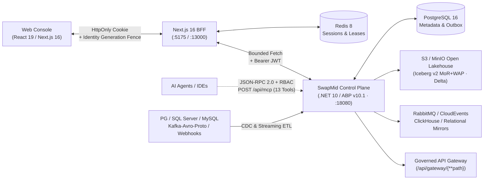

# SwapMid

[](https://github.com/q871958549/SwapMid/releases)
[](LICENSE)
[](https://dotnet.microsoft.com/)
[](https://abp.io/)
[](https://nextjs.org/)
[](https://www.typescriptlang.org/)

English | **[简体中文](README.zh-CN.md)**

**SwapMid** is an open-source, production-grade **Enterprise Data Exchange & Integration Platform** (Control Plane) built on **.NET 10 (ABP v10.1)** and **Next.js 16 (React 19)**.

Rather than acting as a low-level broker or single-purpose connector, SwapMid operates as a unified **integration hub** above your databases, event brokers (`Kafka`, `Redpanda`, `RabbitMQ`), object stores (`S3`, `MinIO`), and upstream APIs — unifying **Heterogeneous Real-Time CDC**, **Zero-JVM Open Lakehouse (`Apache Iceberg v2` & `Delta Lake`)**, **Idempotent Streaming ETL**, **Durable Event Bus**, **Governed API Gateway**, and an **AI-Native MCP Control Plane** behind a zero-browser-token BFF console.

---

## Why SwapMid?

| Pillar | What You Get Out of the Box |
| --- | --- |
| **Heterogeneous CDC & Zero-JVM Open Lakehouse** | Native capture across **5 CDC sources** — PostgreSQL Logical Replication (`pgoutput`), SQL Server Change Tracking (`CHANGETABLE`), MySQL / MariaDB Row-Based Binlog (`ROW` + `FULL`), Serverless HMAC-SHA256 **Push Webhook CDC** (with Auto-Schema Inference & Dead-Letter Replay Ledger), and **Kafka / Redpanda Debezium** streams (JSON + **Confluent / Redpanda Schema Registry Wire-Format Binary Avro & Protobuf**). Writes directly into **Apache Delta Lake** (`_delta_log`) and pure-.NET **Apache Iceberg v2** (binary Apache Avro 1.11 OCF `snap-*.avro` / `*-m0.avro` / `*-d0.avro`, Parquet `FieldId 1..12` & `TIMESTAMP_MICROS`, native **`day(commit_timestamp_utc)` Hidden Partitioning**, **Merge-on-Read Equality Deletes** `content=2`, partition-aware `REPLACE` compaction, **WAP Named Tags & `staging` Branch Isolation with Fast-Forward Promotion**, reference-counted **`expireSnapshots` orphan GC**, and **Scheduled Hangfire Maintenance Policies**) — verified live with official **DuckDB v2.0.0 `iceberg_scan()`**. |
| **Chaos-Tested Idempotent Streaming ETL** | Bounded-memory streaming pipelines across PostgreSQL, SQL Server, MySQL, REST APIs, and CSV/Excel into relational targets, Kafka, ClickHouse, or S3/MinIO Parquet. Includes an interactive visual field mapper, zero-row schema pre-flight diagnostics, dialect-native atomic `upsert`, and transactional **Target Receipt v1** (`__swapmid_etl_receipt_v1`) guaranteeing **`RPO = 0`** across crashes and retries. |
| **Durable Event Bus & CloudEvents 1.0** | Cross-engine transactional Outbox (`DataIntegration` -> `MessageBus`), structured subscription routing (`subject:<glob>`, `$.jsonPath=value`), exponential retry & set-based batch dead-letter replay, plus CNCF **CloudEvents v1.0** HTTP Webhooks (`HMAC-SHA256` + SSRF guard), RabbitMQ, and Bot Webhooks (Slack / Feishu / DingTalk / WeCom). |
| **API Gateway, Cross-Engine Lineage, GitOps & MCP** | Fail-closed dynamic API Gateway (`/api/gateway/{**path}` with DNS-rebinding-safe SSRF guard, per-client ACLs, and sliding-window rate limits), interactive **Cross-Engine Data Lineage & Blast-Radius Impact Explorer** (`GET /api/v1/integration-lineage{,/impact}` spanning DataSources -> Pipelines/CDC -> Lakehouse/MessageBus -> Subscriptions & Gateway), secret-free **`swapmid.io/v1` Declarative GitOps Bundles** (`Export` / `Diff` / `Dry-Run Apply` API, Web Console, `scripts/swapmidctl.mjs` with `${ENV_SECRET:...}` resolution, and reusable GitHub Action PR drift gate), RBAC-gated **MCP Server** (`POST /api/mcp`, **13 read-only diagnostic & `Draft`-only copilot tools**, **100.0% `207/207` `/api/v1` OpenAPI summary coverage**), and a Next.js 16 BFF storing OAuth2 tokens strictly in Redis with optional S256 PKCE **External OIDC SSO**. |

---

## Architecture Overview



- Detailed DDD layering, BFF sequence diagrams, Target Receipt v1 protocol, and security invariants: **[docs/architecture.md](docs/architecture.md)**
- Fault-injection chaos contracts & 1,000-row Parquet/Iceberg v2 SLA benchmarks (`15,134 rows/s`, `RPO = 0`): **[docs/benchmarks/resilience-and-chaos.md](docs/benchmarks/resilience-and-chaos.md)**

---

## Quick Start (Docker Compose)

1. Copy the environment template and replace placeholder secrets before production deployment:
   ```bash
   cd docker
   cp .env.example .env
   ```
2. Build and launch the complete stack (PostgreSQL 16, Redis 8, RabbitMQ 3.13, Seq, automatic DB migrations & demo seed, API Host, and Next.js BFF):
   ```bash
   docker compose up -d --build
   ```
   > Want an instant **MySQL 8.4 (`ROW` Binlog) + MinIO** or **Redpanda (Kafka + Schema Registry) + MinIO + DuckDB** Lakehouse sandbox? Overlay either turnkey demo file:
   > ```bash
   > docker compose -f docker-compose.yml -f docker-compose.lakehouse-demo.yml up -d --build
   > # or: Redpanda + Schema Registry + Iceberg v2 WAP + DuckDB
   > docker compose -f docker-compose.yml -f docker-compose.streaming-lakehouse.yml up -d --build
   > ```
3. Access the platform:
   - **Web Console**: `http://localhost:13000`
     - Default seeded administrator: **`admin`** / **`1q2w3E*`** *(rotate immediately before external exposure)*
   - **API Readiness & Swagger UI**: `http://localhost:18080/health/ready` · `http://localhost:18080/swagger`
   - **RabbitMQ Management**: `http://localhost:25672`
   - **Seq Structured Logs**: `http://localhost:15341`
4. Run the built-in zero-dependency demos right after signing in — or execute `node scripts/e2e-smoke.mjs` from the repo root to verify all 7 end-to-end checks automatically:
   - **Data Integration**: Run **`demo-orders-pg-to-pg`** to stream 12 seeded orders from `public.etl_demo_source_orders` into `public.etl_demo_target_orders` with idempotent `RunId` replay.
   - **Message Bus**: Publish a JSON event to **`integration.pipeline.events`** and inspect live AMQP delivery via **`demo-pipeline-events-rmq`** (`swapmid.demo.events`).
   - **API Management & Docs**: Test **`Platform Diagnostics`** (`/gw/demo/health`), issue a `client_credentials` app, and inspect the live **Database Dictionary**.

---

## Local Development

### Prerequisites
- **.NET SDK 10.0+**
- **Node.js 24+** & **pnpm 11+** (via `corepack enable`)
- **PostgreSQL 16+** and **Redis 8+** (or start backing infrastructure via `./scripts/dev.ps1 -InfraOnly` / `./scripts/dev.sh --infra-only`)

### One-Command Dev Startup
```bash
# Windows PowerShell
pwsh ./scripts/dev.ps1

# Linux / macOS / WSL2
./scripts/dev.sh
```

### Manual Step-by-Step Startup
```bash
# 1. Apply EF Core migrations & seed demo data
dotnet run --project src/SwapMid.DbMigrator

# 2. Start Backend Control Plane (https://localhost:44362)
dotnet run --project src/SwapMid.HttpApi.Host

# 3. Start Frontend BFF Console (http://localhost:5175)
cd web && cp .env.example .env.local && pnpm install --frozen-lockfile && pnpm dev
```

---

## Module Matrix

| Domain | Key Capabilities | Primary Paths |
| --- | --- | --- |
| **Data Integration** | Multi-source connectors & sinks (`Kafka` + Schema Registry Avro/Protobuf, `ClickHouse`, `S3/MinIO Parquet`), visual field mapper, streaming ETL + Target Receipt v1, 5-source CDC (`pgoutput`, `SQL Server CT`, `MySQL Binlog`, `Push Webhook` + dead-letter replay, `Kafka/Redpanda Debezium Avro/Protobuf/JSON`), Apache Iceberg v2 (binary Avro OCF + `day(ts)` hidden partitioning + **Merge-on-Read Equality Deletes** + **WAP Staging Branch / Promote, Named Tags & Cron `expireSnapshots` GC**) & Delta Lake Time-Travel, Zero-Infra live Parquet preview, Data Contract SLA, Unity Catalog / Iceberg REST sync, **Cross-Engine Data Lineage & Impact Explorer**, and **`swapmid.io/v1` GitOps Bundles + `swapmidctl` + PR Action** | `src/SwapMid.*/DataIntegration` · `src/SwapMid.HttpApi/{GitOps,Lineage}` · `scripts/swapmidctl.mjs` |
| **Message Bus** | Topics, structured subscription filters, transactional outbox, delivery attempts, batch dead-letter replay, CloudEvents v1.0 HMAC webhooks, RabbitMQ, Bot webhooks | `src/SwapMid.*/MessageBus` · `web/src/app/(dashboard)/message-bus` |
| **API Management** | API groups, fail-closed dynamic gateway (`/api/gateway/*`), rate limiting & ACLs, interactive test console, OpenIddict `client_credentials` apps, 13-tool MCP Server (`/api/mcp`) | `src/SwapMid.*/ApiManagement` · `src/SwapMid.HttpApi.Host/Mcp` · `web/src/app/(dashboard)/api-management` |
| **Scheduling** | Unified Hangfire/Cron job definitions, distributed concurrency locks, manual/dry-run triggers & execution logs | `src/SwapMid.*/Scheduling` · `web/src/app/(dashboard)/system/scheduled-jobs` |
| **Notification** | Multi-channel templates (`Webhook`, `SMTP Email`), incoming Prometheus Alertmanager webhook (`X-SwapMid-Alert-Token`) | `src/SwapMid.*/Notification` · `web/src/app/(dashboard)/system/notification` |
| **Identity & Governance** | Users, roles, permission tree & diff/export, 5-invariant impersonation guard, organization directory, two-tier dictionaries, code rules, audit logs, native Prometheus system health | `src/SwapMid.*/{AccountManagement,EnterpriseManagement,SystemManagement}` |
| **Developer Docs** | Generated OpenAPI reference (`207/207` 100.0% summary coverage) + live EF Core & external database schema dictionary | `src/SwapMid.*/DeveloperDocs` · `web/src/app/(dashboard)/docs` |

---

## Quality, Terminology & Security Gates

Run the exact verification suite enforced in [GitHub Actions CI](.github/workflows/ci.yml):

```bash
# Backend zero-warning Release build (TreatWarningsAsErrors=true) & full test suite
dotnet build SwapMid.slnx -c Release --nologo
dotnet test SwapMid.slnx -c Release --no-build --nologo

# Frontend typecheck, dependency/cycle audit, ESLint + trilingual i18n & terminology guard, UI ratchet & build
cd web
npx tsc --noEmit
pnpm check:deps
pnpm lint
pnpm check:ui
pnpm test:security-deps
pnpm check:api-summary
pnpm test:run
pnpm build
```

---

## Documentation, Cloud-Native Delivery & Community

- **Roadmap & Changelog**: **[docs/roadmap.md](docs/roadmap.md)** (`v0.1.0` -> `v2.8.0` & beyond) · **[CHANGELOG.md](CHANGELOG.md)**
- **Chaos & SLA Benchmarks**: **[docs/benchmarks/resilience-and-chaos.md](docs/benchmarks/resilience-and-chaos.md)**
- **Cloud-Native & Operations**: Kubernetes Helm v3 chart ([`charts/swapmid/`](charts/swapmid/)) · Turnkey Prometheus/Grafana/Alertmanager overlay ([`docker/docker-compose.observability.yml`](docker/docker-compose.observability.yml)) · **[Operations & Upgrade Runbook](docs/operations-and-upgrade.md)** · Runnable integration recipes ([`examples/`](examples/))
- **Contributing & Security**: **[CONTRIBUTING.md](CONTRIBUTING.md)** · **[SECURITY.md](SECURITY.md)**

---

## License

Licensed under the **[Apache License 2.0](LICENSE)**.
