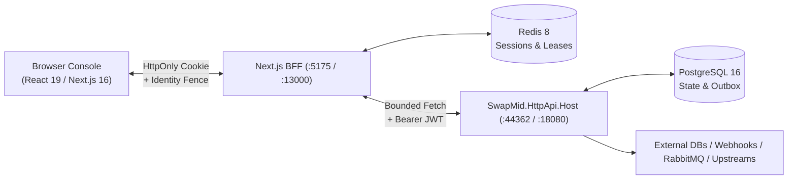

# SwapMid

[](LICENSE)
[](https://dotnet.microsoft.com/)
[](https://abp.io/)
[](https://nextjs.org/)
[](https://www.typescriptlang.org/)

English | **[简体中文](README.zh-CN.md)**

**SwapMid** is an open-source, production-grade **Enterprise Integration & Data Swap Middleware** built on **.NET 10 (ABP v10)** and **Next.js 16 (React 19)**. It unifies cross-database streaming ETL pipelines, durable event/webhook delivery, and governed API gateway forwarding behind a security-hardened BFF admin console.

---

## Highlights

- **Heterogeneous CDC Engine, Push Webhook Ingress & Native Delta / Iceberg v2 Lakehouse**
  - Capture consistent snapshots and row-level changes across **PostgreSQL Logical Replication (`pgoutput`)**, **SQL Server Change Tracking (`CHANGETABLE`)**, **MySQL / MariaDB Row-Based Binlog (`ROW` + `FULL`)**, and serverless HMAC-SHA256 **Push Webhook CDC** (`POST /api/v1/cdc-webhooks/{streamId}`), with `WAL`/`Binlog` lag telemetry, replication pre-flight diagnostics, and automatic upstream **Schema Drift** circuit-breaking (`Ignore` / `Warn` / `PauseAndAlert`).
  - Route CDC streams into the **Message Bus**, **Relational Table Mirrors** (`FieldMappings` + `SoftDelete` tombstones with resurrection clearing), or external **Kafka** / **ClickHouse** (`ReplacingMergeTree` auto-DDL) / **S3 & MinIO Object Storage (`Parquet`/`JSONL`)**.
  - Emit native **Apache Delta Lake (`_delta_log/{version:D20}.json`)** and pure-.NET **Apache Iceberg v2 (`metadata/v*.metadata.json` + `snap-*-manifest.json` + `version-hint.text`)** commits with S3 `If-None-Match: *` optimistic concurrency, automatic or on-demand `OPTIMIZE` / `REPLACE` compaction, interactive **Time-Travel Inspector** (`VERSION AS OF v` / `iceberg_scan()`) with **Zero-Infra Live Parquet/JSONL Data Preview**, declarative **Data Contract & Freshness SLA** guardrails, and non-blocking metadata registration to **Unity Catalog REST** and **Apache Iceberg REST**.
- **Chaos-Tested Fault Tolerance & Idempotent Streaming ETL**
  - Multi-source connectors across **PostgreSQL**, **SQL Server**, **MySQL**, **REST APIs**, and **CSV / Excel** files, plus **Kafka**, **ClickHouse**, and **Object Storage** sinks (`DataIntegration:Sinks` SSRF allowlist), interactive **PipelineFieldMapperPanel**, and zero-row **Schema Pre-flight** diagnostics (`POST /api/v1/data-pipelines/preflight-schema`).
  - Batch streaming execution (`append`, `truncate`, and watermark-guarded dialect-native atomic `upsert`), paired with transactional **Target Receipt v1** (`__swapmid_etl_receipt_v1`) to guarantee idempotent target writes.
- **Durable Message Bus, CloudEvents 1.0 & Cross-Engine Outbox**
  - Automatic transactional Outbox bridge (`DataIntegration` -> `MessageBus`) emits idempotent `pipeline.execution.*` events onto `integration.pipeline.events` whenever a pipeline run finishes.
  - Topic/subscription routing with structured filtering (`subject:<glob>`, `$.jsonPath=value`, `;`-joined `AND`), persistent delivery attempts, exponential backoff retries, and set-based batch dead-letter replay (`POST /api/v1/message-records/batch-replay`).
  - Built-in **HTTP Webhook** (CNCF **CloudEvents v1.0** `ce-*` headers + `HMAC-SHA256` `X-SwapMid-Signature` + outbound SSRF guard), **RabbitMQ**, and **BotWebhook** (Generic JSON, Slack, Feishu/Lark, DingTalk, WeCom) channels.
- **Governed API Gateway, Event Ingress & Controlled MCP Server**
  - Dynamic API groups and route forwarding (`/api/gateway/{**path}`, fail-closed by default via `ApiGateway:Enabled=false`) with DNS-rebinding-safe SSRF protection, per-client route-group ACLs, sliding-window rate limiting (`429` + `Retry-After`), and idempotent partner event ingress (`POST /api/gateway/events/{topicName}`).
  - Opt-in RBAC-enforced **MCP Server** (`POST /api/mcp`, default `Mcp:Enabled=false`) exposing 8 read-only/diagnostic/draft tools (including `propose_pipeline_column_mappings`, `evaluate_cdc_data_contracts`, `diagnose_cdc_streams`, and `Draft`-only pipeline authoring) with **100% `/api/v1` OpenAPI summary coverage (`197/197`)**.
- **Zero-Browser-Token BFF Console & Optional External OIDC SSO**
  - Next.js `16.4.6` BFF stores OAuth2 tokens exclusively in Redis behind `HttpOnly` session cookies (`swapmid_sid`), enforces cloud-persisted table views with zero background 404s, and supports both local credentials and S256 PKCE **External OIDC Federation** (`AuthServer:ExternalOidc`).
- **Cloud-Native Helm & Turnkey Observability**
  - Official Kubernetes Helm v3 chart ([`charts/swapmid/`](charts/swapmid/)), runnable integration blueprints ([`examples/`](examples/)), Prometheus + Grafana + Alertmanager closed-loop observability overlay ([`docker/docker-compose.observability.yml`](docker/docker-compose.observability.yml)), and [Operations & Upgrade Runbook](docs/operations-and-upgrade.md).

---

## Architecture Overview



See **[docs/architecture.md](docs/architecture.md)** for sequence diagrams, DDD layering, Target Receipt v1 design, and BFF security invariants.

---

## Quick Start (Docker Compose)

1. Copy the environment template and review/replace placeholder secrets:
   ```bash
   cd docker
   cp .env.example .env
   ```
2. Build and launch the full stack (PostgreSQL 16, Redis 8, RabbitMQ 3.13, Seq, automatic DB migrations & demo seed, API Host, and Next.js BFF):
   ```bash
   docker compose up -d --build
   ```
3. Open the services:
   - **Web Console**: `http://localhost:13000`
     - Default seeded administrator: **`admin`** / **`1q2w3E*`** *(rotate immediately before production exposure)*
   - **API Host & Readiness**: `http://localhost:18080/health/ready` · Swagger UI: `http://localhost:18080/swagger`
   - **RabbitMQ Management**: `http://localhost:25672`
   - **Seq Structured Logs**: `http://localhost:15341`
4. Try the zero-dependency built-in demos right after signing in (or run `node scripts/e2e-smoke.mjs` from the repo root):
   - **Data Integration**: Trigger **`demo-orders-pg-to-pg`** to stream 12 seeded orders from `public.etl_demo_source_orders` into `public.etl_demo_target_orders`.
   - **Message Bus**: Publish a test JSON event to **`integration.pipeline.events`** and inspect live AMQP delivery via **`demo-pipeline-events-rmq`** (`swapmid.demo.events`).
   - **API Management & Docs**: Inspect the **`Platform Diagnostics`** route (`/gw/demo/health`), provision a **`client_credentials`** app, and browse the live **Database Dictionary**.

---

## Local Development

### Prerequisites
- **.NET SDK 10.0+**
- **Node.js 24+** & **pnpm 11+** (via `corepack enable`)
- **PostgreSQL 16+** and **Redis 8+** (or start backing services via `./scripts/dev.ps1 -InfraOnly` / `./scripts/dev.sh --infra-only`)

### One-Command Dev Startup
```bash
# Windows PowerShell
pwsh ./scripts/dev.ps1

# Linux / macOS / WSL2
./scripts/dev.sh
```

### Manual Step-by-Step Startup

#### 1. Initialize Database & Demo Seed
```bash
dotnet run --project src/SwapMid.DbMigrator
```

#### 2. Start Backend API Host (`https://localhost:44362`)
```bash
dotnet run --project src/SwapMid.HttpApi.Host
```

#### 3. Start Frontend BFF Console (`http://localhost:5175`)
```bash
cd web
cp .env.example .env.local
pnpm install --frozen-lockfile
pnpm dev
```

---

## Module Matrix

| Domain | Key Capabilities | Primary Paths |
| --- | --- | --- |
| **Data Integration** | Data sources & sinks (`Kafka`/`ClickHouse`/`S3 Parquet`), visual field mapper, streaming ETL pipelines, heterogeneous CDC (`pgoutput`/`SQL Server CT`/`MySQL Binlog`), Delta Lake Time-Travel (`_delta_log`), Unity Catalog / Iceberg REST sync, Target Receipt v1 | `src/SwapMid.*/DataIntegration` · `web/src/app/(dashboard)/data-integration` |
| **Message Bus** | Topics, subscriptions, outbox records, delivery attempts, HMAC HTTP webhooks, RabbitMQ, Bot webhooks | `src/SwapMid.*/MessageBus` · `web/src/app/(dashboard)/message-bus` |
| **API Management** | API groups, gateway routes (`/api/gateway/*`), interactive test console, OpenIddict third-party apps | `src/SwapMid.*/ApiManagement` · `web/src/app/(dashboard)/api-management` |
| **Scheduling** | Unified Cron job definitions, distributed execution locks, manual trigger & execution logs | `src/SwapMid.*/Scheduling` · `web/src/app/(dashboard)/system/scheduled-jobs` |
| **Notification** | Multi-channel templates (`Webhook`, `SMTP Email`), incoming Prometheus Alertmanager webhook (`X-SwapMid-Alert-Token`) | `src/SwapMid.*/Notification` · `web/src/app/(dashboard)/system/notification` |
| **Identity & Admin** | Users, roles, permission tree & diff/export, 5-invariant impersonation guard, enterprises/departments/employees, dictionaries, code rules, audit logs, system health | `src/SwapMid.*/{AccountManagement,EnterpriseManagement,SystemManagement}` |
| **Developer Docs** | Generated OpenAPI endpoint explorer + live EF Core & external DB schema dictionary | `src/SwapMid.*/DeveloperDocs` · `web/src/app/(dashboard)/docs` |

---

## Quality & Security Gates

Run the same checks enforced in [CI](.github/workflows/ci.yml):

```bash
# Backend build (zero warnings via common.props) & full test suite
dotnet build SwapMid.slnx -c Release --nologo
dotnet test SwapMid.slnx -c Release --no-build --nologo

# Frontend typecheck, dead-code/cycle check, ESLint + i18n audit, UI ratchet & tests
cd web
npx tsc --noEmit
pnpm check:deps
pnpm lint
pnpm check:ui
pnpm test:security-deps
pnpm check:api-summary
pnpm test:run
pnpm build
```

---

## Roadmap, Contributing & Security

- Architecture & long-term roadmap (`v0.2.0` -> `v2.2+`): **[docs/roadmap.md](docs/roadmap.md)** · **[CHANGELOG.md](CHANGELOG.md)** · **[Chaos & Resilience Report](docs/benchmarks/resilience-and-chaos.md)**
- Turnkey MySQL 8.4 Binlog + Delta Lakehouse Docker overlay: [`docker/docker-compose.lakehouse-demo.yml`](docker/docker-compose.lakehouse-demo.yml) (`196/196` `/api/v1` OpenAPI summary coverage)
- Contribution workflow and coding standards: **[CONTRIBUTING.md](CONTRIBUTING.md)**
- Vulnerability disclosure policy: **[SECURITY.md](SECURITY.md)**

---

## License

Licensed under the **[Apache License 2.0](LICENSE)**.
