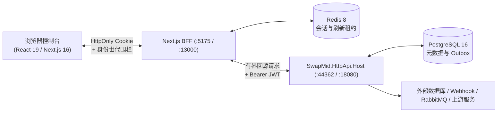

# SwapMid

[](LICENSE)
[](https://dotnet.microsoft.com/)
[](https://abp.io/)
[](https://nextjs.org/)
[](https://www.typescriptlang.org/)

**[English](README.md)** | 简体中文

**SwapMid** 是一款生产级开源 **企业数据交换与集成中间件（Enterprise Integration & Data Swap Middleware）**，基于 **.NET 10（ABP v10）** 与 **Next.js 16（React 19）** 构建，将跨库流式 ETL 管道、可靠事件/Webhook 消息总线与受治理的 API 网关统一在零前端令牌暴露的 BFF 管理控制台中。

---

## 核心特性

- **异构实时 CDC 引擎、关系表行级镜像与 Apache Delta Lake 开放湖仓**
  - 原生支持 **PostgreSQL 逻辑复制（`pgoutput`）**、**SQL Server Change Tracking（`CHANGETABLE`）** 与 **MySQL / MariaDB Row-Based Binlog（`ROW` + `FULL`）** 一致性初始快照与增量捕获，集成位点预检、字节级 `WAL`/`Binlog` 滞留监测及上游 DDL **Schema 漂移**自动熔断护栏（`Ignore` / `Warn` / `PauseAndAlert`）。
  - 支持将 CDC 变更流实时投递至 **消息总线**、**关系表行级镜像**（显式列重映射 + `SoftDelete` 软删除墓碑与复活清零）或外部分析端 **Kafka** / **ClickHouse**（一键 `ReplacingMergeTree` 建表）/ **S3 & MinIO 对象存储（Parquet / JSONL）**。
  - 支持写入原生 **Apache Delta Lake `_delta_log/{version:D20}.json`** 事务日志（S3 `If-None-Match: *` 乐观并发锁），联动自动/手动 `OPTIMIZE` 小文件压缩合并，提供在线 **Time-Travel 时间旅行版本检视器**（`VERSION AS OF v`）与 **零外部计算集群实时 Parquet/JSONL 样本行预览**、声明式 **数据契约与新鲜度 SLA 引擎**，并支持非阻塞同步元数据至 **Unity Catalog REST** 与 **Apache Iceberg REST**。
- **混沌工程故障注入验证与生产级幂等执行引擎**
  - 内置 **PostgreSQL**、**SQL Server**、**MySQL**、**REST API** 与 **CSV / Excel** 多源连接器及 **Kafka / ClickHouse / 对象存储** Sink（含严格 `DataIntegration:Sinks` SSRF 守卫），提供交互式 **`PipelineFieldMapperPanel` 字段映射器** 与激活前零行只读 **Schema 兼容性预检**（`POST /api/v1/data-pipelines/preflight-schema`）。
  - 全链路分批流式执行（支持 `append`、`truncate` 与带水位线保护的多方言原子 `upsert`），配合目标库事务级幂等回执表 **`__swapmid_etl_receipt_v1`**，确保跨库重跑零重复写入，关键故障恢复场景均通过混沌契约测试校验（详见 **[混沌与韧性基准报告](docs/benchmarks/resilience-and-chaos.md)**）。
- **可靠消息总线、CloudEvents 1.0 与跨引擎事务 Outbox**
  - 内置跨引擎事务性 Outbox 桥接（`DataIntegration` -> `MessageBus`）：ETL 管道进入终态时自动在同事务内入队并幂等发布 `pipeline.execution.*` 事件至 `integration.pipeline.events`。
  - 支持主题（Topic）/ 订阅（Subscription）结构化过滤（兼容纯子串、`subject:<通配符>`、`$.jsonPath=value` 及 `;` 多条件与组合）、持久化投递明细、指数退避自动重试与集合化批量死信重放（`POST /api/v1/message-records/batch-replay`）。
  - 原生支持 **HTTP Webhook**（CNCF **CloudEvents v1.0** 标准 `ce-*` 头 + `HMAC-SHA256` `X-SwapMid-Signature` 签名 + 出站 SSRF 防护）、**RabbitMQ** 以及通用 **BotWebhook**（Generic JSON / Slack / 飞书 / 钉钉 / 企业微信群机器人格式）。
- **生产级 API 网关、异步事件接入与受控 MCP Server**
  - 动态 API 分组与网关转发（`/api/gateway/{**path}`，默认 `ApiGateway:Enabled=false` 安全关闭），内置防 DNS 重绑定 SSRF 守卫、客户端路由组 ACL、滑动窗口分钟级限流（`429` + `Retry-After`）及幂等事件接入（`POST /api/gateway/events/{topicName}`）。
  - 可选开启受平台 RBAC 约束的 **MCP Server**（`POST /api/mcp`，默认 `Mcp:Enabled=false`），提供含 `propose_pipeline_column_mappings`、`evaluate_cdc_data_contracts` 与 `diagnose_cdc_streams` 在内的 **8 个**只读诊断与 `Draft` 草稿生成工具，且全部 **196 个 `/api/v1` 接口 100.0% 具备 OpenAPI 摘要**。
- **零浏览器令牌 BFF 架构与可选外部 OIDC 单点登录**
  - Next.js `16.4.6` BFF 将 OAuth2 令牌完全托管于服务端 Redis，支持云端持久化表格偏好与零控制台 404 运行态，同时支持本地账号密码与 S256 PKCE **外部企业 OIDC 身份联邦**（`AuthServer:ExternalOidc`）。
- **云原生 Helm 交付与开箱即用可观测性闭环**
  - 提供官方 Kubernetes Helm Chart（[`charts/swapmid/`](charts/swapmid/)）、可运行场景模板库（[`examples/`](examples/)）、Prometheus + Grafana + Alertmanager 闭环可观测性编排（[`docker/docker-compose.observability.yml`](docker/docker-compose.observability.yml)）与 [生产运维及升级手册](docs/operations-and-upgrade.md)。

---

## 架构概览



完整分层职责、BFF 时序图、Target Receipt v1 幂等模型与安全边界详见 **[docs/architecture.md](docs/architecture.md)**。

---

## 快速开始（Docker Compose）

1. 复制环境变量模板并按需替换为强密钥：
   ```bash
   cd docker
   cp .env.example .env
   ```
2. 一键构建并启动完整服务栈（PostgreSQL 16、Redis 8、RabbitMQ 3.13、Seq、自动数据库迁移与演示种子初始化、API Host 及 Next.js BFF）：
   ```bash
   docker compose up -d --build
   ```
   > 如需一键拉起含 **MySQL 8.4（`ROW` Binlog 预置表）+ MinIO Delta Lake 湖仓沙箱** 的全功能体验栈，可叠加湖仓覆盖编排：
   > `docker compose -f docker-compose.yml -f docker-compose.lakehouse-demo.yml up -d --build`
3. 访问服务入口：
   - **管理控制台**：`http://localhost:13000`
     - 默认初始化管理员账号：**`admin`** / **`1q2w3E*`** *（生产环境暴露前请立即修改密码）*
   - **后端健康检查与 Swagger**：`http://localhost:18080/health/ready` · `http://localhost:18080/swagger`
   - **RabbitMQ 管理面板**：`http://localhost:25672`
   - **Seq 结构化日志**：`http://localhost:15341`
4. 登录后即可零外部依赖体验三大内置演示闭环（也可在仓库根目录直接运行 `node scripts/e2e-smoke.mjs` 自动验活）：
   - **数据集成**：手动执行 **`demo-orders-pg-to-pg`** 管道，将 `public.etl_demo_source_orders` 中的 12 条演示订单流式同步至 `public.etl_demo_target_orders`。
   - **消息总线**：向 **`integration.pipeline.events`** 主题发布测试 JSON 事件，查看 **`demo-pipeline-events-rmq`** 订阅投递至本地 RabbitMQ 交换机 `swapmid.demo.events` 的实时轨迹。
   - **API 管理与文档**：查看 **`Platform Diagnostics`** 分组与 `/gw/demo/health` 路由、签发 **`client_credentials`** 第三方凭证，并浏览实时 **数据库表字典**。

---

## 本地开发指南

### 环境要求
- **.NET SDK 10.0+**
- **Node.js 24+** 与 **pnpm 11+**（推荐开启 `corepack enable`）
- **PostgreSQL 16+** 与 **Redis 8+**（可直接通过 `./scripts/dev.ps1 -InfraOnly` 或 `./scripts/dev.sh --infra-only` 一键拉起基础设施）

### 一键启动本地开发环境
```bash
# Windows PowerShell
pwsh ./scripts/dev.ps1

# Linux / macOS / WSL2
./scripts/dev.sh
```

### 分步手动启动

#### 1. 执行数据库迁移与演示种子写入
```bash
dotnet run --project src/SwapMid.DbMigrator
```

#### 2. 启动后端 API Host（`https://localhost:44362`）
```bash
dotnet run --project src/SwapMid.HttpApi.Host
```

#### 3. 启动前端 BFF 控制台（`http://localhost:5175`）
```bash
cd web
cp .env.example .env.local
pnpm install --frozen-lockfile
pnpm dev
```

---

## 模块矩阵

| 业务域 | 核心能力 | 主要目录 |
| --- | --- | --- |
| **数据集成（DataIntegration）** | 多源连接器与 Sink（`Kafka`/`ClickHouse`/`S3 Parquet`）、可视化字段映射、流式 ETL、异构 CDC（`pgoutput`/`SQL Server CT`/`MySQL Binlog`）、Delta Lake Time-Travel、Unity Catalog / Iceberg REST 同步、Target Receipt v1 | `src/SwapMid.*/DataIntegration` · `web/src/app/(dashboard)/data-integration` |
| **消息总线（MessageBus）** | 主题与订阅管理、持久化消息记录与投递轨迹、HMAC HTTP Webhook、RabbitMQ、群机器人 Webhook | `src/SwapMid.*/MessageBus` · `web/src/app/(dashboard)/message-bus` |
| **API 网关（ApiManagement）** | API 分组、网关路由转发（`/api/gateway/*`）、在线调试控制台、OpenIddict 第三方客户端凭证管理 | `src/SwapMid.*/ApiManagement` · `web/src/app/(dashboard)/api-management` |
| **统一调度（Scheduling）** | Cron 任务注册、分布式执行互斥锁、手动触发与执行历史 | `src/SwapMid.*/Scheduling` · `web/src/app/(dashboard)/system/scheduled-jobs` |
| **通知与告警（Notification）** | 多通道通知模板（`Webhook`、`SMTP Email`）、Prometheus Alertmanager 告警回调接入 | `src/SwapMid.*/Notification` · `web/src/app/(dashboard)/system/notification` |
| **账号与系统治理** | 用户/角色/权限树与差异导出、模拟登录安全守卫、企业组织目录、两级数据字典、编码规则、审计日志、系统健康 | `src/SwapMid.*/{AccountManagement,EnterpriseManagement,SystemManagement}` |
| **开发者文档（DeveloperDocs）** | 自动生成的 OpenAPI 接口参考 + 实时 EF Core 与外部数据源表结构字典 | `src/SwapMid.*/DeveloperDocs` · `web/src/app/(dashboard)/docs` |

---

## 工程质量与安全门禁

本地可执行与 [GitHub Actions CI](.github/workflows/ci.yml) 完全一致的全量门禁：

```bash
# 后端零警告编译与全套单元/集成测试（common.props 默认启用 WarningsAsErrors）
dotnet build SwapMid.slnx -c Release --nologo
dotnet test SwapMid.slnx -c Release --no-build --nologo

# 前端类型检查、死代码/循环依赖门禁、ESLint + 中英繁三语审计、UI 复杂度棘轮与单元测试
cd web
npx tsc --noEmit
pnpm check:deps
pnpm lint
pnpm check:ui
pnpm test:security-deps
pnpm check:api-summary
pnpm test:run
pnpm build
```

---

## 演进路线图、贡献与安全披露

- 长期架构演进路线图（`v0.2.0` -> `v2.2+`）请参阅 **[docs/roadmap.md](docs/roadmap.md)** · **[CHANGELOG.md](CHANGELOG.md)** · **[混沌与韧性基准](docs/benchmarks/resilience-and-chaos.md)**
- 贡献流程与代码规范请参阅 **[CONTRIBUTING.md](CONTRIBUTING.md)**
- 安全漏洞私密披露流程请参阅 **[SECURITY.md](SECURITY.md)**

---

## 开源许可

本项目采用 **[Apache License 2.0](LICENSE)** 开源许可证发布。
