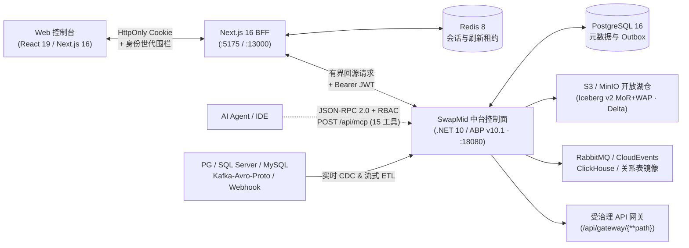

# SwapMid

[](https://github.com/q871958549/SwapMid/releases)
[](LICENSE)
[](https://dotnet.microsoft.com/)
[](https://abp.io/)
[](https://nextjs.org/)
[](https://www.typescriptlang.org/)

**[English](README.md)** | 简体中文

**SwapMid** 是一款生产级开源 **企业级数据交换与集成中台**（Enterprise Data Exchange & Integration Platform），基于 **.NET 10（ABP v10.1）** 与 **Next.js 16（React 19）** 单栈构建。

SwapMid 并非底层队列或单一通信协议组件，而是运行在关系型数据库、消息队列（`Kafka` / `Redpanda` / `RabbitMQ`）、对象存储（`S3` / `MinIO`）与上下游业务系统之上的统一**集成控制平面**——将**异构实时 CDC**、**零 JVM 开放湖仓（`Apache Iceberg v2` / `Delta Lake`）**、**幂等流式 ETL**、**可靠事件总线**、**受治理 API 网关**与 **AI 原生 MCP 控制面** 收敛在同一套零浏览器令牌暴露的 BFF 控制台之中。

---

## 为什么选择 SwapMid？

| 核心能力域 | 开箱即用的生产级能力 |
| --- | --- |
| **异构实时 CDC 与零 JVM 开放湖仓** | 原生覆盖 **5 类 CDC 数据源**：PostgreSQL 逻辑复制（`pgoutput`）、SQL Server Change Tracking（`CHANGETABLE`）、MySQL / MariaDB Row-Based Binlog（`ROW` + `FULL`）、无服务器 HMAC-SHA256 **Push Webhook CDC**（内置自动 Schema 推导与死信重放台账）以及 **Kafka / Redpanda Debezium 流**（原生支持 JSON 与 **Confluent / Redpanda Schema Registry 二进制 Avro 与 Protobuf 线协议解码**）。直写 **Apache Delta Lake**（`_delta_log`）与纯 .NET 零 JVM **Apache Iceberg v2**（二进制 Apache Avro 1.11 OCF `snap-*.avro` / `*-m0.avro` / `*-d0.avro`、Parquet `FieldId 1..12+` 与 `TIMESTAMP_MICROS`、原生 **`day(commit_timestamp_utc)` 按日隐藏分区**、**Merge-on-Read 主键 Upsert（`content=2` Equality Deletes）**、**不可变 `FieldId` 原生 Schema Evolution（类型化业务列提升、免重写列重命名与永不复用删列）**、同日分区感知 `REPLACE` 压缩、**WAP 隔离分支（`staging`）快进发布、命名审计标签（`refs`）与可逆原子时间旅行回滚**、严格引用计数 **`expireSnapshots` 孤儿清理**、**Prometheus FinOps 存储计量**及 **Hangfire 定时维护策略**），经官方 **DuckDB v2.0.0 `iceberg_scan()`** 实机验证跨 Schema 历史读取、零重写重命名、分支隔离与原子回滚。 |
| **混沌验证的幂等流式 ETL** | 面向 PostgreSQL、SQL Server、MySQL、REST API、CSV/Excel 与 Kafka / ClickHouse / S3-MinIO Parquet 的有界内存流式管道；内置可视化字段映射器、零行只读 Schema 预检、多方言原子 `upsert` 与目标库事务级回执表 **Target Receipt v1**（`__swapmid_etl_receipt_v1`），在断连崩溃与并发重跑下实现 **`RPO = 0`**。 |
| **可靠事件总线与 CloudEvents 1.0** | 跨引擎事务性 Outbox（`DataIntegration` -> `MessageBus`）、主题/订阅结构化过滤（`subject:<通配符>`、`$.jsonPath=value`）、指数退避自动重试与集合化批量死信重放，原生支持 CNCF **CloudEvents v1.0** HTTP Webhook（`HMAC-SHA256` 签名 + 出站 SSRF 防护）、RabbitMQ 及飞书/钉钉/企微/Slack 群机器人通道。 |
| **API 网关、OpenLineage 2.0、OTLP 链路、GitOps 与 MCP** | 默认安全关闭的动态 API 网关（`/api/gateway/{**path}`，防 DNS 重绑定 SSRF 守卫、客户端路由组 ACL 与滑动窗口限流）、交互式**跨引擎字段级血缘、影响面分析与 CNCF OpenLineage 2.0（`v2-0-2`）导出及可选 Webhook 推送**（`GET /api/v1/integration-lineage{,/impact,/openlineage}`，对接 Marquez / DataHub / OpenMetadata）、零明文密钥 **`swapmid.io/v1` 声明式 GitOps 集成清单**（`Export` / `Diff` / `Dry-Run Apply` API、Web 控制台、支持 `${ENV_SECRET:...}` 密钥占位解析的 `scripts/swapmidctl.mjs` CLI 与可复用 GitHub Action PR 漂移门禁）、受平台 RBAC 约束的 **MCP Server**（`POST /api/mcp`，内置 **15 个只读诊断与 `Draft` 草稿生成工具**，`/api/v1` 接口 **100.0% `210/210` OpenAPI 摘要覆盖**）、全链路 **W3C TraceContext**（`traceparent` -> `X-SwapMid-Trace-Id`）联动一键 **Prometheus + Grafana Tempo OTLP** 三支柱可观测编排，以及零前端令牌暴露的 Next.js 16 BFF 控制台（支持 S256 PKCE **外部企业 OIDC 单点登录**）。 |

---

## 架构概览



- 完整 DDD 分层职责、BFF 鉴权时序图、Target Receipt v1 幂等协议与安全边界：详见 **[docs/architecture.md](docs/architecture.md)**
- 混沌故障注入契约与 1,000 行 Parquet / Iceberg v2 吞吐 SLA 实测（`15,134 rows/s`、`RPO = 0`）：详见 **[docs/benchmarks/resilience-and-chaos.md](docs/benchmarks/resilience-and-chaos.md)**

---

## 5 分钟快速开始（Docker Compose）

1. 复制环境变量模板，并在生产暴露前替换占位强密钥：
   ```bash
   cd docker
   cp .env.example .env
   ```
2. 一键构建并启动完整中台栈（PostgreSQL 16、Redis 8、RabbitMQ 3.13、Seq、自动数据库迁移与演示数据种子、后端控制面与 Next.js BFF）：
   ```bash
   docker compose up -d --build
   ```
   > 如需一键体验 **MySQL 8.4（`ROW` Binlog）+ MinIO** 或 **Redpanda（Kafka + Schema Registry）+ MinIO + DuckDB** 开放湖仓沙箱，叠加对应编排文件即可：
   > ```bash
   > docker compose -f docker-compose.yml -f docker-compose.lakehouse-demo.yml up -d --build
   > # 或：Redpanda + Schema Registry + Iceberg v2 WAP + DuckDB
   > docker compose -f docker-compose.yml -f docker-compose.streaming-lakehouse.yml up -d --build
   > ```
3. 访问服务入口：
   - **Web 控制台**：`http://localhost:13000`
     - 默认管理员账号：**`admin`** / **`1q2w3E*`** *（生产环境暴露前请立即修改密码）*
   - **后端健康检查与 Swagger**：`http://localhost:18080/health/ready` · `http://localhost:18080/swagger`
   - **RabbitMQ 管理面板**：`http://localhost:25672`
   - **Seq 结构化日志**：`http://localhost:15341`
4. 登录后即可零外部依赖体验内置演示闭环（或在仓库根目录直接运行 `node scripts/e2e-smoke.mjs` 自动执行 7 项全栈验活）：
   - **数据集成**：手动触发 **`demo-orders-pg-to-pg`**，将 `public.etl_demo_source_orders` 中的 12 条订单流式写入 `public.etl_demo_target_orders` 并验证 `RunId` 幂等重放。
   - **消息总线**：向 **`integration.pipeline.events`** 发布测试事件，观测 **`demo-pipeline-events-rmq`** 实时投递至本地 RabbitMQ 交换机 `swapmid.demo.events`。
   - **API 管理与文档**：调试 **`Platform Diagnostics`** 网关路由（`/gw/demo/health`）、签发 `client_credentials` 第三方应用并浏览实时 **数据库表字典**。

---

## 本地开发指南

### 环境要求
- **.NET SDK 10.0+**
- **Node.js 24+** 与 **pnpm 11+**（建议开启 `corepack enable`）
- **PostgreSQL 16+** 与 **Redis 8+**（可通过 `./scripts/dev.ps1 -InfraOnly` 或 `./scripts/dev.sh --infra-only` 一键拉起依赖服务）

### 一键启动本地开发环境
```bash
# Windows PowerShell
pwsh ./scripts/dev.ps1

# Linux / macOS / WSL2
./scripts/dev.sh
```

### 分步手动启动
```bash
# 1. 执行数据库迁移与演示数据初始化
dotnet run --project src/SwapMid.DbMigrator

# 2. 启动后端控制面（https://localhost:44362）
dotnet run --project src/SwapMid.HttpApi.Host

# 3. 启动前端 BFF 控制台（http://localhost:5175）
cd web && cp .env.example .env.local && pnpm install --frozen-lockfile && pnpm dev
```

---

## 模块矩阵

| 业务域 | 核心能力 | 主要目录 |
| --- | --- | --- |
| **数据集成（DataIntegration）** | 多源连接器与 Sink（`Kafka` + Schema Registry Avro/Protobuf / `ClickHouse` / `S3 & MinIO Parquet`）、可视化字段映射、流式 ETL + Target Receipt v1、5 类异构 CDC（`pgoutput` / `SQL Server CT` / `MySQL Binlog` / `Push Webhook` + 死信重放 / `Kafka-Redpanda Debezium Avro/Protobuf/JSON`）、Apache Iceberg v2（二进制 Avro OCF + `day(ts)` 按日隐藏分区 + **Merge-on-Read Equality Deletes** + **WAP `staging` 分支与快进发布、审计标签与定时 `expireSnapshots` 清理**）与 Delta Lake Time-Travel、零计算集群 Parquet 实时预览、数据契约 SLA、Unity Catalog / Iceberg REST 同步、**跨引擎血缘图谱与影响面分析**以及 **`swapmid.io/v1` 声明式 GitOps 清单 + `swapmidctl` + PR Action** | `src/SwapMid.*/DataIntegration` · `src/SwapMid.HttpApi/{GitOps,Lineage}` · `scripts/swapmidctl.mjs` |
| **消息总线（MessageBus）** | 主题与结构化订阅过滤、跨引擎事务 Outbox、持久化投递明细与批量死信重放、CloudEvents v1.0 HMAC Webhook、RabbitMQ、群机器人 Webhook | `src/SwapMid.*/MessageBus` · `web/src/app/(dashboard)/message-bus` |
| **API 网关（ApiManagement）** | API 分组、默认安全关闭的动态网关转发（`/api/gateway/*`）、客户端 ACL 与限流、在线调试台、OpenIddict 第三方凭证、13 工具 MCP Server（`/api/mcp`） | `src/SwapMid.*/ApiManagement` · `src/SwapMid.HttpApi.Host/Mcp` · `web/src/app/(dashboard)/api-management` |
| **统一调度（Scheduling）** | Hangfire / Cron 任务注册、分布式执行互斥锁、手动/试运行触发与执行历史 | `src/SwapMid.*/Scheduling` · `web/src/app/(dashboard)/system/scheduled-jobs` |
| **通知与告警（Notification）** | 多通道通知模板（`Webhook`、`SMTP Email`）、Prometheus Alertmanager 告警回调接入（`X-SwapMid-Alert-Token`） | `src/SwapMid.*/Notification` · `web/src/app/(dashboard)/system/notification` |
| **账号与系统治理** | 用户/角色/权限树与差异导出、5 不变式模拟登录守卫、企业组织架构目录、两级数据字典、编码规则、审计日志、原生 Prometheus 系统健康 | `src/SwapMid.*/{AccountManagement,EnterpriseManagement,SystemManagement}` |
| **开发者文档（DeveloperDocs）** | 自动生成的 OpenAPI 接口参考（`207/207` 100.0% 摘要覆盖）+ 实时 EF Core 与外部数据源表结构字典 | `src/SwapMid.*/DeveloperDocs` · `web/src/app/(dashboard)/docs` |

---

## 工程质量、术语一致性与安全门禁

本地可执行与 [GitHub Actions CI](.github/workflows/ci.yml) 完全一致的全量门禁：

```bash
# 后端零警告编译与全套单元/集成/架构测试（common.props 默认启用 WarningsAsErrors）
dotnet build SwapMid.slnx -c Release --nologo
dotnet test SwapMid.slnx -c Release --no-build --nologo

# 前端类型检查、依赖/循环门禁、ESLint + 三语 i18n 与术语防乱翻译门禁、UI 棘轮与构建
cd web
npx tsc --noEmit
pnpm check:deps
pnpm lint
pnpm check:ui
pnpm test:security-deps
pnpm check:api-summary
pnpm test:run
pnpm build
```

---

## 文档导航、云原生交付与社区

- **演进路线图与版本变更**：**[docs/roadmap.md](docs/roadmap.md)**（`v0.1.0` -> `v2.8.0` 及后续规划）· **[CHANGELOG.md](CHANGELOG.md)**
- **混沌工程与 SLA 基准**：**[docs/benchmarks/resilience-and-chaos.md](docs/benchmarks/resilience-and-chaos.md)**
- **云原生交付与运维**：官方 Kubernetes Helm Chart（[`charts/swapmid/`](charts/swapmid/)）· Prometheus / Grafana / Alertmanager 闭环可观测编排（[`docker/docker-compose.observability.yml`](docker/docker-compose.observability.yml)）· **[生产运维与升级手册](docs/operations-and-upgrade.md)** · 可运行场景模板库（[`examples/`](examples/)）
- **贡献与安全披露**：**[CONTRIBUTING.md](CONTRIBUTING.md)** · **[SECURITY.md](SECURITY.md)**

---

## 开源许可

本项目采用 **[Apache License 2.0](LICENSE)** 开源许可证发布。
