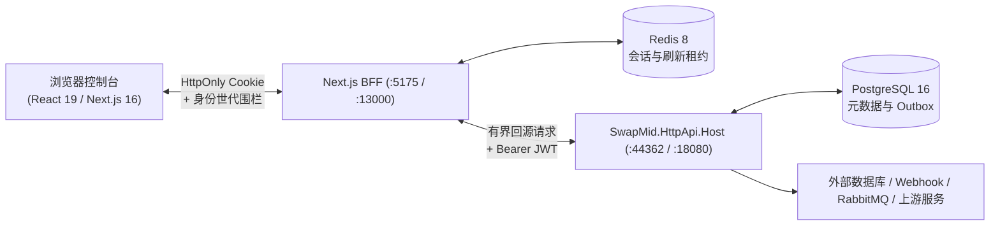

# SwapMid

[](LICENSE)
[](https://dotnet.microsoft.com/)
[](https://abp.io/)
[](https://nextjs.org/)
[](https://www.typescriptlang.org/)

**[English](README.md)** | 简体中文

**SwapMid** 是一款生产级开源 **企业数据交换与集成中间件（Enterprise Integration & Data Swap Middleware）**，基于 **.NET 10（ABP v10）** 与 **Next.js 16（React 19）** 构建，将跨库流式 ETL 管道、可靠事件/Webhook 消息总线与受治理的 API 网关统一在零前端令牌暴露的 BFF 管理控制台中。

---

## 核心特性

- **流式数据集成与幂等目标回执（Target Receipt v1）**
  - 内置 **PostgreSQL**、**SQL Server**、**MySQL**、**REST API** 与 **CSV / Excel** 多源连接器。
  - 全链路分批流式读取与字段映射转换，避免大表全量驻留内存；配合目标库事务级幂等回执表 **`__swapmid_etl_receipt_v1`**，确保跨库重跑零重复写入。
- **可靠消息总线与多通道投递**
  - 支持主题（Topic）/ 订阅（Subscription）解耦路由、持久化投递明细（Outbox / Delivery Attempt）、指数退避自动重试与一键人工重放。
  - 原生支持 **HTTP Webhook**（`HMAC-SHA256` `X-SwapMid-Signature` 签名 + 出站 SSRF 防护）、**RabbitMQ** 以及通用 **BotWebhook**（Generic JSON / Slack / 飞书 / 钉钉 / 企业微信群机器人格式）。
- **API 网关管理与第三方凭证授权**
  - 动态 API 分组与网关转发（`/api/gateway/{**path}`，默认通过 `ApiGateway:Enabled=false` 安全默认关闭）、交互式在线调试台，以及基于 **OpenIddict** `client_credentials` 模式（`external-integration` 作用域）的第三方应用授权管理。
- **零浏览器令牌暴露的 BFF 安全架构**
  - Next.js 16 BFF 将 OAuth2 访问令牌与刷新令牌完全托管于服务端 Redis，浏览器仅持有 `HttpOnly` 会话 Cookie（`swapmid_sid`），内置分布式单飞刷新锁与多标签页身份世代围栏（`409 SESSION_IDENTITY_CHANGED`）。
- **开箱即用的平台级治理底座**
  - 统一 Cron 调度中心、满足 5 项安全不变量的管理员模拟登录守卫（`ImpersonationGuardService`）、企业/部门/岗位/员工主数据、两级数据字典、编码规则、审计日志、Prometheus Alertmanager 告警接入（`X-SwapMid-Alert-Token`）与在线 OpenAPI / 数据库字典文档。

---

## 架构概览



完整分层职责、BFF 时序图、Target Receipt v1 幂等模型与安全边界详见 **[docs/architecture.md](docs/architecture.md)**。

---

## 快速开始（Docker Compose）

1. 复制环境变量模板并按需替换为强密钥：
   ```bash
   cd docker
   cp .env.example .env
   ```
2. 一键构建并启动完整服务栈（PostgreSQL 16、Redis 8、RabbitMQ 3.13、Seq、自动数据库迁移与演示种子初始化、API Host 及 Next.js BFF）：
   ```bash
   docker compose up -d --build
   ```
3. 访问服务入口：
   - **管理控制台**：`http://localhost:13000`
     - 默认初始化管理员账号：**`admin`** / **`1q2w3E*`** *（生产环境暴露前请立即修改密码）*
   - **后端健康检查与 Swagger**：`http://localhost:18080/health/ready` · `http://localhost:18080/swagger`
   - **RabbitMQ 管理面板**：`http://localhost:25672`
   - **Seq 结构化日志**：`http://localhost:15341`
4. 登录后即可零外部依赖体验三大内置演示闭环（也可在仓库根目录直接运行 `node scripts/e2e-smoke.mjs` 自动验活）：
   - **数据集成**：手动执行 **`demo-orders-pg-to-pg`** 管道，将 `public.etl_demo_source_orders` 中的 12 条演示订单流式同步至 `public.etl_demo_target_orders`。
   - **消息总线**：向 **`integration.pipeline.events`** 主题发布测试 JSON 事件，查看 **`demo-pipeline-events-rmq`** 订阅投递至本地 RabbitMQ 交换机 `swapmid.demo.events` 的实时轨迹。
   - **API 管理与文档**：查看 **`Platform Diagnostics`** 分组与 `/gw/demo/health` 路由、签发 **`client_credentials`** 第三方凭证，并浏览实时 **数据库表字典**。

---

## 本地开发指南

### 环境要求
- **.NET SDK 10.0+**
- **Node.js 24+** 与 **pnpm 11+**（推荐开启 `corepack enable`）
- **PostgreSQL 16+** 与 **Redis 8+**（可直接通过 `./scripts/dev.ps1 -InfraOnly` 或 `./scripts/dev.sh --infra-only` 一键拉起基础设施）

### 一键启动本地开发环境
```bash
# Windows PowerShell
pwsh ./scripts/dev.ps1

# Linux / macOS / WSL2
./scripts/dev.sh
```

### 分步手动启动

#### 1. 执行数据库迁移与演示种子写入
```bash
dotnet run --project src/SwapMid.DbMigrator
```

#### 2. 启动后端 API Host（`https://localhost:44362`）
```bash
dotnet run --project src/SwapMid.HttpApi.Host
```

#### 3. 启动前端 BFF 控制台（`http://localhost:5175`）
```bash
cd web
cp .env.example .env.local
pnpm install --frozen-lockfile
pnpm dev
```

---

## 模块矩阵

| 业务域 | 核心能力 | 主要目录 |
| --- | --- | --- |
| **数据集成（DataIntegration）** | 多源连接器、字段映射、流式 ETL 管道、Cron 调度执行、Target Receipt v1（`__swapmid_etl_receipt_v1`） | `src/SwapMid.*/DataIntegration` · `scripts/data-integration/target-receipt-v1/` |
| **消息总线（MessageBus）** | 主题与订阅管理、持久化消息记录与投递轨迹、HMAC HTTP Webhook、RabbitMQ、群机器人 Webhook | `src/SwapMid.*/MessageBus` · `web/src/app/(dashboard)/message-bus` |
| **API 网关（ApiManagement）** | API 分组、网关路由转发（`/api/gateway/*`）、在线调试控制台、OpenIddict 第三方客户端凭证管理 | `src/SwapMid.*/ApiManagement` · `web/src/app/(dashboard)/api-management` |
| **统一调度（Scheduling）** | Cron 任务注册、分布式执行互斥锁、手动触发与执行历史 | `src/SwapMid.*/Scheduling` · `web/src/app/(dashboard)/system/scheduled-jobs` |
| **通知与告警（Notification）** | 多通道通知模板（`Webhook`、`SMTP Email`）、Prometheus Alertmanager 告警回调接入 | `src/SwapMid.*/Notification` · `web/src/app/(dashboard)/system/notification` |
| **账号与系统治理** | 用户/角色/权限树与差异导出、模拟登录安全守卫、企业组织目录、两级数据字典、编码规则、审计日志、系统健康 | `src/SwapMid.*/{AccountManagement,EnterpriseManagement,SystemManagement}` |
| **开发者文档（DeveloperDocs）** | 自动生成的 OpenAPI 接口参考 + 实时 EF Core 与外部数据源表结构字典 | `src/SwapMid.*/DeveloperDocs` · `web/src/app/(dashboard)/docs` |

---

## 工程质量与安全门禁

本地可执行与 [GitHub Actions CI](.github/workflows/ci.yml) 完全一致的全量门禁：

```bash
# 后端零警告编译与全套单元/集成测试
dotnet build SwapMid.slnx -c Release --warnaserror
dotnet test SwapMid.slnx -c Release

# 前端类型检查、死代码/循环依赖门禁、ESLint + 中英繁三语审计、UI 复杂度棘轮与单元测试
cd web
npx tsc --noEmit
pnpm check:deps
pnpm lint
pnpm check:ui
pnpm test:security-deps
pnpm check:api-summary
pnpm test:run
pnpm build
```

---

## 贡献与安全披露

- 贡献流程与代码规范请参阅 **[CONTRIBUTING.md](CONTRIBUTING.md)**
- 安全漏洞私密披露流程请参阅 **[SECURITY.md](SECURITY.md)**

---

## 开源许可

本项目采用 **[Apache License 2.0](LICENSE)** 开源许可证发布。
