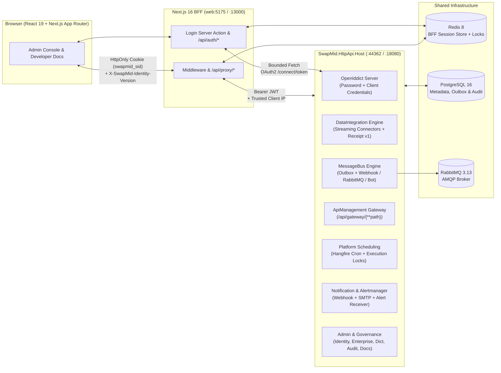
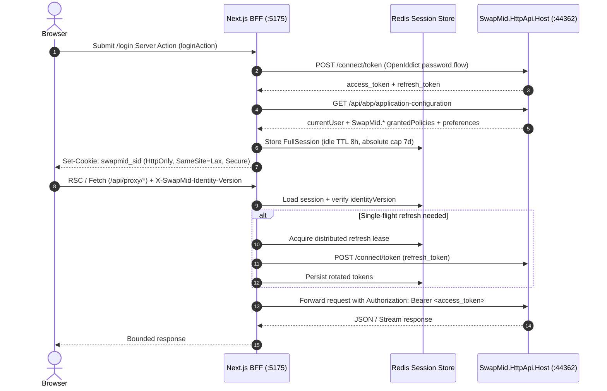

# SwapMid Architecture & Design Reference

SwapMid is a clean-architecture enterprise integration & data swap middleware built on **.NET 10 (ABP v10)** and **Next.js 16 (App Router)**. It unifies streaming ETL pipelines, durable event delivery, and governed API gateway forwarding behind a single BFF-hardened admin console.

---

## 1. High-Level Topology

---

## 2. Solution Layering (.NET 10 / ABP v10)

SwapMid follows strict Domain-Driven Design (DDD) layering across `src/` and `test/`:

| Project | Responsibility |
| --- | --- |
| `SwapMid.Domain.Shared` | Constants, enums, error codes (`SwapMid:*`), localization JSON (`zh-Hans`, `zh-Hant`, `en`), and options contracts. |
| `SwapMid.Domain` | Aggregate roots, entities, domain services (`ImpersonationGuardService`, pipeline/topic/gateway domain models), and repository interfaces. |
| `SwapMid.Application.Contracts` | Request/response DTOs, permission definitions (`SwapMidPermissions`), and application service interfaces. |
| `SwapMid.Application` | Application services, streaming ETL runners, MessageBus dispatchers, notification channels, and scheduling handlers. |
| `SwapMid.EntityFrameworkCore` | EF Core 10 `SwapMidDbContext` (PostgreSQL via Npgsql), entity mappings, indexes, and live schema metadata reader. |
| `SwapMid.HttpApi` | Versioned REST controllers (`/api/v1/*`) and Alertmanager webhook receiver. |
| `SwapMid.HttpApi.Host` | ASP.NET Core 10 host, OpenIddict server setup, Hangfire recurring scheduler, fail-closed API Gateway controller (`/api/gateway/{**path}`), rate limiting, health checks (`/health/live`, `/health/ready`, `/health-status`), and Prometheus metrics. |
| `SwapMid.DbMigrator` | Idempotent schema migration and initial seed runner (admin role/user, OpenIddict applications & scopes, default dictionaries, and zero-dependency ETL/MessageBus/Gateway demos). |

---

## 3. Security & BFF Session Architecture

Tokens are **never** exposed to browser JavaScript (`localStorage` or readable cookies):

### Key BFF & Identity Safeguards
- **Identity Generation Fencing (`409 SESSION_IDENTITY_CHANGED`)**: Every tab binds to an `identityVersion` UUID. Account switches or admin impersonation transitions rotate `identityVersion` so stale tabs cannot submit mutations under the wrong principal.
- **5-Invariant Impersonation Guard (`ImpersonationGuardService`)**:
  1. Caller must hold `SwapMid.AccountUser.Impersonate`.
  2. Self-impersonation is rejected.
  3. Target account must be active and unlocked.
  4. Target accounts holding `admin` or `Impersonate` cannot be impersonated (no lateral privilege escalation).
  5. Chained/nested impersonation is forbidden.
- **Bounded Upstream Fetch (`serverBackendFetch`)**: Enforces explicit per-category deadlines, byte caps (`Content-Length` pre-check + streaming chunk counter), path-segment traversal rejection (`%2e%2e` multi-pass decode), and `redirect: 'manual'`.

---

## 4. Core Integration Engines

### 4.1 DataIntegration Engine & Target Receipt v1
- **Multi-Source Connectors**: PostgreSQL, SQL Server, MySQL, REST APIs, and structured files (`CSV` / `Excel`).
- **Streaming Execution**: Source readers stream batches directly into field-mapping transforms and target writers without materializing full tables in memory.
- **Target Receipt v1 (`__swapmid_etl_receipt_v1`)**:
  - Guarantees idempotent cross-database synchronization via a transactional receipt table on target databases (`PostgreSQL`, `MySQL`, `SQL Server`).
  - Ready-to-apply DBA DDL scripts are maintained in `scripts/data-integration/target-receipt-v1/`.

### 4.2 MessageBus Engine
- **Topics & Subscriptions**: Decouples event producers from downstream consumers with schema/topic governance and per-subscription routing.
- **Transactional Outbox & Delivery Attempts**: Records every dispatch attempt, HTTP status, latency, error summary, and retry schedule, supporting manual one-click replay.
- **Delivery Channels**:
  - **HTTP Webhook**: Signs payloads with `HMAC-SHA256` (`X-SwapMid-Signature`) and enforces outbound SSRF IP/CIDR validation.
  - **RabbitMQ**: Publishes messages to configured AMQP exchanges and routing keys.
  - **BotWebhook**: Formats operational/event notifications for Generic JSON, Slack, Feishu (Lark), DingTalk, and WeCom group webhooks.

### 4.3 ApiManagement & Gateway
- **API Groups & Routes**: Organizes upstream HTTP endpoints under managed route paths (`/api/gateway/{**path}`, fail-closed by default via `ApiGateway:Enabled=false`) with method, ordering, and enablement controls.
- **Third-Party App Credentials**: Provisions OpenIddict `client_credentials` applications scoped to `external-integration`, with secret rotation and revocation.
- **Interactive Test Console**: Built-in gateway request debugger with latency/header inspection.

### 4.4 Platform Scheduling & Notification
- **Scheduling**: Unified Hangfire Cron job registry, concurrency gates, dry-run preview, manual triggers, and execution history across ETL, MessageBus retries, and system maintenance jobs.
- **Notification & Alertmanager**: Multi-channel notification templates (`Webhook`, `SMTP Email`) plus a built-in Prometheus Alertmanager receiver at `POST /api/v1/notification/webhooks/alertmanager` authenticated via constant-time `X-SwapMid-Alert-Token` comparison.

---

## 5. Quality & Contract Gates

Every change across backend and frontend is guarded by deterministic CI checks (`.github/workflows/ci.yml`):

1. **Backend Build & Tests**: `dotnet build SwapMid.slnx -c Release --warnaserror` + `dotnet test SwapMid.slnx -c Release` (Domain, Application, EntityFrameworkCore SQLite in-memory, and HttpApi suites).
2. **OpenAPI Contract Sync**: `RuntimeSwaggerContractTests` (`SWAPMID_UPDATE_OPENAPI_SNAPSHOT=1` / `pnpm sync:api:fast`) -> `docs/api/openapi.generated.json` -> `@hey-api/openapi-ts` (`pnpm gen:api` & `pnpm gen:api-doc`) + `pnpm check:api-summary` + `pnpm verify:api:clean`.
3. **Frontend Type, Dependency & Lint Gates**:
   - `npx tsc --noEmit`
   - `pnpm check:deps` (`knip` dead-code gate + `dependency-cruiser` runtime circular-dependency gate)
   - `pnpm lint` (`eslint --max-warnings=0` including custom `swapmid/*` UI governance rules + full frontend/backend `zh-Hans`/`zh-Hant`/`en` parity audit)
   - `pnpm check:ui` (AST route complexity ratchet + UI rule-card budget)
   - `pnpm test:security-deps` (supply-chain lockfile & transitive `minimatch`/`brace-expansion` bounds)
   - `pnpm test:run` (Vitest unit/component tests) & `pnpm build` (Next.js standalone production build)
4. **Full-Stack Container E2E (`scripts/e2e-smoke.mjs`)**: Boots `postgres`, `redis`, `rabbitmq`, `seq`, `migrator`, `api`, and `web` in Docker Compose and verifies live ETL sync, RabbitMQ event delivery, OpenIddict `client_credentials`, scheduled jobs, DB dictionary, and BFF auth boundaries.
